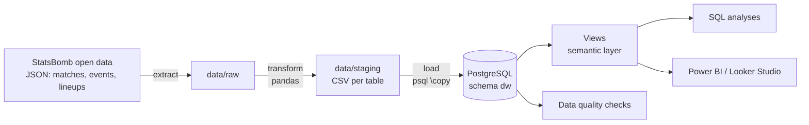
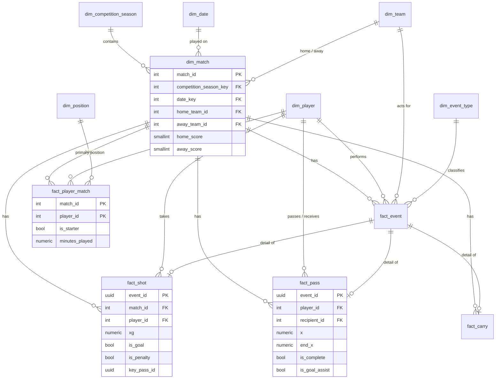

# ⚽ Football Data Warehouse — PostgreSQL star schema
## Bundesliga 2023/24 (Bayer Leverkusen) + UEFA Euro 2024

A dimensional data warehouse built from StatsBomb open event data:
a Python ETL pipeline, a PostgreSQL star schema, a semantic layer of
analytical views, automated data-quality checks, and 10 SQL analyses.

**85 matches · 325,689 events · 93,102 passes · 2,232 shots · 1,007 players · 42 teams**

This warehouse is the data source for my BI projects: Power BI and Looker Studio connect
straight to the `v_` views.

---

## Architecture



---

## Star schema



| Table | Grain | Rows |
|---|---|---:|
| `fact_event` | one row per event (pass, pressure, duel, ...) | 325,689 |
| `fact_pass` | one row per pass | 93,102 |
| `fact_carry` | one row per carry | 76,526 |
| `fact_player_match` | one row per player per match played | 2,638 |
| `fact_shot` | one row per shot (penalty shootouts excluded) | 2,232 |
| `dim_player` · `dim_team` · `dim_match` · `dim_date` · `dim_position` · `dim_event_type` · `dim_competition_season` | descriptive attributes | — |

**Design decisions**
- **Specialised fact tables** (`fact_shot`, `fact_pass`, `fact_carry`) share the `event_id` of `fact_event`. Analysts get narrow, typed tables for the most common questions instead of a single 100-column event table.
- **`dim_player` is a role-playing dimension**: it is joined as both passer and receiver in `fact_pass`.
- **Minutes played are rebuilt from the event stream** (Starting XI, substitutions, red cards), handling stoppage time period by period. StatsBomb's lineup "position spells" overlap in some extra-time matches, which the data-quality checks caught (see below).
- **Penalty shootouts (period 5)** stay in `fact_event` but are excluded from `fact_shot` and from playing time, so shootout kicks don't count as goals.

---

## Semantic layer (views)

| View | What it gives you |
|---|---|
| `v_pass` | passes with `is_progressive`, `into_final_third`, `into_box` flags |
| `v_carry` | carries with an `is_progressive` flag |
| `v_team_match` | two rows per match (one per team): result, points, xG, xGA, pass share |
| `v_player_season` | player × team × competition: goals, xG, npxG, xA, progression, defending, **per-90 metrics** |

*Progressive* = a completed open-play pass (or a carry of 5+ m) that moves the ball at least 25% closer to the centre of the goal and ends in the opponent's half.

---

## Data quality checks

`validation/data_quality_checks.sql` runs 10 automated checks, each returning PASS/FAIL:

| Check | Status |
|---|:---:|
| Goals in `fact_shot` + own goals = official score | ✅ PASS |
| Exactly 11 starters per team per match | ✅ PASS |
| Event coordinates inside the 120 × 80 pitch | ✅ PASS |
| xG between 0 and 1 | ✅ PASS |
| Minutes played ≤ match length | ✅ PASS |
| Team minutes between 10 and 11 players × match length | ✅ PASS |
| No duplicate event index within a match | ✅ PASS |
| Every shooter/passer appears in the match lineup | ✅ PASS |
| Every shot `key_pass_id` exists in `fact_pass` | ✅ PASS |
| Home team differs from away team | ✅ PASS |

The first version of the pipeline **failed three of these checks**. Fixing them made the data model better:
- Penalty-shootout kicks were counted as goals, so Cristiano Ronaldo showed 2 goals at Euro 2024 instead of 0. Fixed by excluding period 5.
- Players in extra-time matches showed up to 166 minutes. The cause was overlapping lineup spells in the source data, and the fix was to rebuild minutes from substitution and red-card events.
- One event had x = 120.1 (a ball on the goal line). I added a documented 0.5-unit tolerance.

---

## SQL analyses

| # | Query | SQL techniques |
|---|---|---|
| 01 | [Finishing over/under-performance](queries/01_finishing_over_under_performance.sql) | derived metrics, aggregate filters |
| 02 | [Leverkusen rolling 5-match form](queries/02_rolling_form_window_functions.sql) | window frames, running totals, named `WINDOW` |
| 03 | [Best ball progressors by position](queries/03_top_progressors_by_position.sql) | `RANK() OVER (PARTITION BY ...)` |
| 04 | [Shot quality by pitch zone](queries/04_shot_quality_by_zone.sql) | `CASE` bucketing, `FILTER`, share of total |
| 05 | [Pressing intensity (PPDA) at Euro 2024](queries/05_pressing_intensity_ppda.sql) | multi-CTE pipeline, team vs opponent joins |
| 06 | [When are goals scored?](queries/06_goal_timing.sql) | `generate_series`, empty buckets |
| 07 | [Top passing combinations](queries/07_top_passing_combinations.sql) | role-playing dimension |
| 08 | [Game state: winning / drawing / losing](queries/08_game_state_analysis.sql) | `LATERAL` join, live score reconstruction |
| 09 | [Euro 2024 expected-goals table](queries/09_euro2024_expected_table.sql) | team aggregation, rank comparison |
| 10 | [Scouting percentiles — Euro 2024 midfielders](queries/10_scouting_percentiles.sql) | `PERCENT_RANK()` |

Full outputs are in [`results/`](results/).

### Key findings

**Leverkusen's unbeaten season was built on control, not luck** ([Q2](results/02_rolling_form_window_functions.txt))
- They won the league with 90 points (28 wins, 6 draws) and held opponents to **about 1.0 xG or less per match** (5-match rolling average) from October onwards.
- The 0-0 against Gladbach in January is the biggest outlier: 2.56 xG against 0.18, yet no goals.

**Finishing: Grimaldo was the league's great over-performer** ([Q1](results/01_finishing_over_under_performance.txt))

| Player | Shots | NP goals | npxG | Goals − xG |
|---|---:|---:|---:|---:|
| Álex Grimaldo | 71 | 10 | 5.21 | **+4.79** |
| Florian Wirtz | 71 | 10 | 7.69 | +2.31 |
| Robert Andrich | 23 | 4 | 1.70 | +2.30 |

**Ball progression** ([Q3](results/03_top_progressors_by_position.txt))
- **Florian Wirtz** had the most progressive actions per 90 of any midfielder (12.9) across both competitions.
- **Jeremie Frimpong** led all defenders by a wide margin (10.1 per 90), 7.3 of which came from carries.
- At Euro 2024, **Lamine Yamal** (12.4) and **Kylian Mbappé** (11.4) were the top progressors among forwards.

**Where goals come from** ([Q4](results/04_shot_quality_by_zone.txt))
- 34% of shots came from the edge of the box, but only 3.3% of them were scored.
- The central penalty area produced the most goals (96).

**Euro 2024 pressing** ([Q5](results/05_pressing_intensity_ppda.txt))
- **Austria** (Ralf Rangnick) pressed hardest, with a PPDA of 5.6.
- Germany ranked 3rd (7.0) and Spain, the eventual champions, 5th (7.3).
- Albania, Slovenia and Italy pressed least.

**Euro 2024: Spain deserved it, Georgia defied the numbers** ([Q9](results/09_euro2024_expected_table.txt))
- Portugal had the best xG difference per match (+0.84) but scored only 5 goals, and were knocked out on penalties.
- Georgia allowed **10.4 xG in 4 matches** (−1.93 per match), the worst in the tournament, yet still reached the round of 16.

---

## How to run

**Requirements:** Python 3.10+, PostgreSQL 14+ (or Docker)

```bash
# 1. Start PostgreSQL
docker compose up -d

# 2. Connection settings
cp .env.example .env
set -a; source .env; set +a

# 3. Install and run the pipeline (downloads ~270 MB of JSON on the first run)
pip install -r requirements.txt
python etl/pipeline.py            # or: extract | transform | load

# 4. Run the data-quality checks and all analyses -> results/
./run_queries.sh
```

To add more competitions, add `(competition_id, season_id)` pairs to `COMPETITIONS` in `etl/pipeline.py`.

**Connecting a BI tool:** point Power BI (PostgreSQL connector) or Looker Studio at the database and use the `dw.v_*` views as sources.

---

## Project structure

```
football-data-warehouse/
├── etl/pipeline.py                 # extract → transform → load
├── sql/
│   ├── 01_schema.sql               # star schema DDL, keys, indexes
│   └── 02_views.sql                # semantic layer
├── validation/
│   └── data_quality_checks.sql     # 10 automated checks
├── queries/                        # 10 SQL analyses
├── results/                        # query outputs
├── run_queries.sh
└── docker-compose.yml
```

---

## Tools & Data

- **Data:** [StatsBomb open data](https://github.com/statsbomb/open-data) (free)
- **Database:** PostgreSQL 16
- **ETL:** Python 3 · `pandas`
- **Concepts:** dimensional modelling (Kimball star schema), ETL, data validation, window functions, per-90 normalisation

*Data provided by StatsBomb (Hudl).*
